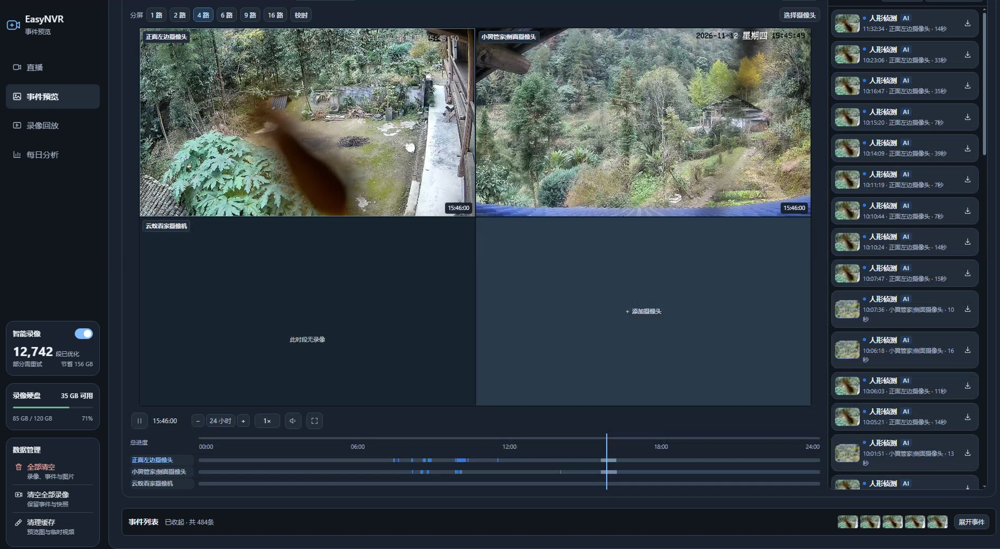
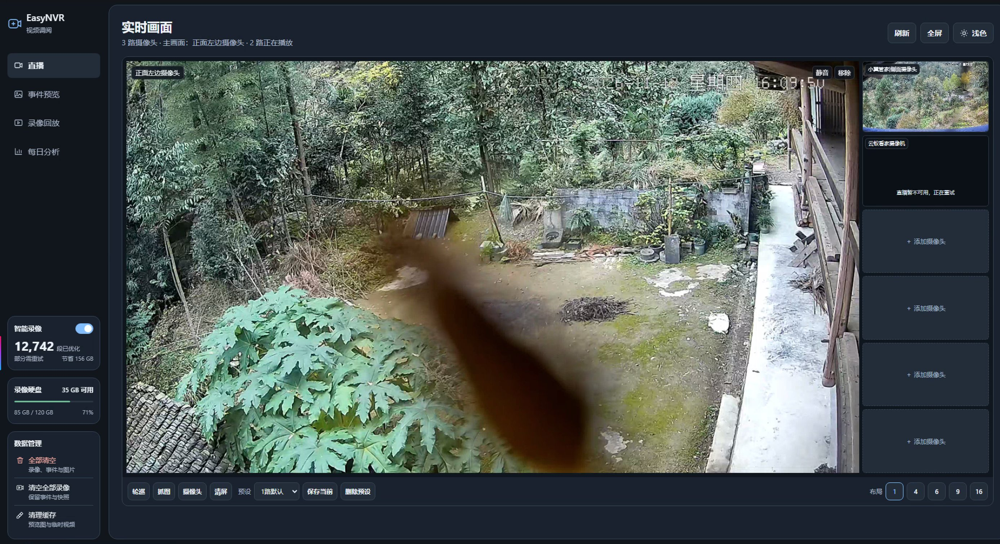

# camera-stream

<p align="center">
  
  
</p>

面向 EasyNVR 的本机摄像头监控增强套件：事件预览、多路录像回放、直播视频墙、YOLO 目标检测、智能录像压缩、按磁盘水位覆盖和 DeepSeek 日报。

> 本项目是围绕本人自建监控环境的实践代码，依赖 EasyNVR 7.7.421、天翼看家 / 云蚁看家客户端等第三方软件。仓库不含这些商业软件及其前端资源，也不含任何设备口令、登录信息或带签名的播放地址。

## 为什么做这个项目

家里的几路摄像头来自不同厂商，原本的用法是：用厂商 App 看直播，用厂商云盘存回放，用 EasyNVR 管录像。这套流程有三个绕不开的问题：

**1. 依赖第三方云存储**

录像存在厂商云盘里，容量、保存天数、清晰度都受套餐限制；免费策略说变就变，想导出原始文件还会被限速或收费。数据在自己手里才对——本地磁盘 + 自己定义的覆盖策略，存多久、存多清、什么时候删，全部可控。

**2. 需要打开多个 App**

天翼看家一个、云蚁看家一个、EasyNVR 一个网页，看一路直播要切三个客户端，回放还要分别找。现在只有一个入口：直播、事件、回放、日报都在同一个页面，摄像头清单跟着 EasyNVR 自动更新。

**3. 最主要的是查看直播和回放要方便**

监控真正高频的动作只有两个：看现在发生了什么，看刚才发生了什么。所以这个项目把重心放在这两件事上——

- 直播：单路主画面 + 右侧预览列，点一下就切换；支持 1/4/6/9/16 分屏、抓图、轮巡和布局预设。
- 回放：多路同步时间轴，拖动总进度各路一起走；事件段按类型上色，点一下直接跳到对应录像；跨段自动续播，缺录单独提示。

### 为什么选 EasyNVR

市面上也有 NAS 自带的监控套件（群晖 Surveillance Station 等），最后选 EasyNVR 是两条现实理由：

**1. 支持 Windows 部署，方便维护**

装成 Windows 服务开机自启，出问题看日志、重启服务即可，不需要为了维护监控去学 Linux、Docker、群晖套件。对"一个人维护、平时不在机房"的场景，这一点比功能多更重要。

**2. 成本最低：一台云电脑就够，不用买 NAS**

最省的做法是一台 Windows 云电脑装 EasyNVR，摄像头按需拉流，录像写本地磁盘，按容量扩容即可。不需要 NAS 硬件、不需要额外电费和硬盘位，也不用为了 RAID 折腾。云电脑可以随时升配，磁盘不够就加盘，用完还能降配。

EasyNVR 本身提供稳定的拉流、录像计划、事件库和设备管理，这个仓库补的是它缺的那一层：好用的聚合界面、多路回放、检测事件、空间治理和日报。

## 功能

| 模块 | 说明 |
| --- | --- |
| `ai-events` | 事件预览、悬停预览、1/4/6 路事件布局；多路同步回放（1–16 路）、事件 MP4 下载、带确认的清理；直播视频墙与预览列 |
| `object-detection` | YOLO26s ONNX 在 CPU 上推理，ByteTrack 追踪，按 EasyNVR 录像计划的类别与时段写事件 |
| `adaptive-recording` | 静止段降帧、活动段保留原帧率，原地替换已完成录像，保留时间轴与音轨 |
| `recording-retention` | 录像盘达到 85.95% 时按最旧片段逐个删除，避免原厂整目录清理 |
| `daily-analysis` | 抽取事件前后连续画面，调用 DeepSeek 生成并校验日报，密钥用 DPAPI 保存 |
| `local-camera-hub` | 云蚁 P2P 取流桥接（32 位 SDK），输出本机 HLS |
| `tianyi-relay.cjs` | 天翼看家 RTSP 转 HLS，签名过期时调用续签脚本 |
| `relay_manager.py` | 按 EasyNVR 启用通道动态起停以上中继 |

## 架构

```
天翼正面/侧面 (RTSP) ──tianyi-relay.cjs──┐
云蚁 (P2P H.264) ──serve_live.py──┤→ 本机 HLS 18765/18766/18767
                                  │
                    EasyNVR (10000)：录像、事件库 data.db
                                  │
   ┌──────────────────────────────┼────────────────────────────┐
ai-events/service.py (18768)  object-detection  adaptive-recording
事件/回放/直播/清理/日报       写 events 表      原地压缩 MP4
   └────────── recording-retention（85.95% 逐文件覆盖）──────────┘
```

## 环境要求

- Windows 10/11，EasyNVR 7.7.421（自带录像与事件数据库）
- Node.js 18+（中继、天翼适配器）
- 64 位 Python 3.12（事件服务、检测、智能录像）
- 32 位 Python 3.12 + 云蚁官方 SDK（仅云蚁接入需要）
- FFmpeg（缩略图、事件拼接、智能录像、抽帧）

## 目录与配置文件

运行前需要按本机环境修改代码顶部的绝对路径常量：

| 文件 | 常量 |
| --- | --- |
| `camera_registry.py` | `DEFAULT_DB`、`DEFAULT_RECORDS` |
| `ai-events/service.py` | `SOURCE_DB`、`RECORD_ROOT`、`FFMPEG` |
| `object-detection/detector.py` | `DB`、`RECORDS`、`FFMPEG` |
| `adaptive-recording/service.py` | `RECORDS`、`SOURCE_DB`、`FFMPEG` |
| `relay_manager.py` | Node、`python32` 可执行文件路径 |
| `tianyi-relay.cjs` | `ffmpeg` 路径 |
| `local-camera-hub/verify_p2p.py` | 云蚁客户端安装目录 |

私有配置（示例见 `local-camera-hub/cameras_p2p_config.example.json`）：

- `local-camera-hub/camera-private.json`：云蚁设备参数，仅保存在本人设备
- `tianyi-private-device-map.json`、`front-live.m3u`、`side-live.m3u`：天翼设备映射与播放地址，由续签脚本生成
- `daily-analysis/data/settings.private.json`：DeepSeek 密钥（DPAPI 加密）

## 启动

```powershell
# 1. 安装并启动 EasyNVR（Windows 服务）
# 2. 启动全部子服务
.\start-all-live.ps1
```

入口：事件预览 <http://127.0.0.1:18768/>，直播 `/live`，回放 `/#replay`，日报 `/daily`。
完整部署、故障恢复与迁移步骤见 [部署手册](摄像头获取与事件预览-完整部署手册.md)。

## 隐私与安全

以下内容**不会**进入仓库，也请勿在提交时加入：

- 设备口令、登录令牌、API Key、带签名的 RTSP 地址
- 云蚁 `camera-private.json`、天翼设备映射与续签结果
- EasyNVR 配置备份、`data.db` 副本
- 录像、事件截图、日报证据图片
- EasyNVR 前端资源与第三方 SDK 二进制

仓库只包含原创代码与文档。`ai-events/artplayer.js`（ArtPlayer，MIT）、`ai-events/hls.light.min.js`（hls.js，Apache-2.0，见 `hls.LICENSE`）为第三方文件，保留原许可。

## 免责声明

EasyNVR、天翼看家、云蚁看家及其 SDK 归各自厂商所有。本仓库不包含、也不再分发它们的程序或资源；相关适配代码仅用于本人设备，使用前请确认符合厂商条款与当地法律。监控数据涉及隐私，请自行做好访问控制。

## 许可证

[MIT](LICENSE)
